# MLOps-Integrated Fraud Detection with Drift-Aware Retraining

**A comparative study of retraining policies under concept drift** - MD3135 Data Science Course Project, Computer Engineering, AY 2026-27
Guide: Dr. Kapil Vhatkar · Team Lead: Aditya Katkar

> Status: **Mid-Sem complete on real data; End-Sem core experiments (drift-triggered policy, cost model, TreeSHAP, dashboard, tests, CI)
> already implemented** - see [Changelog](#6-changelog). The *Results* section below is generated automatically from `results/` by
> `python -m src.make_readme`. Never edit it by hand. **Live demo:** `streamlit run app/dashboard.py`.

---

## 1. Overview

Credit-card fraud models degrade after deployment because fraud tactics and cardholder behaviour keep changing (concept drift).
Most studies report a single static train/test split. We instead **replay the IEEE-CIS Fraud Detection data chronologically**,
detect drift, and compare three retraining policies on both predictive performance and operational cost.

### Research questions (the spine of the paper)

| # | Question | Phase |
|---|---|---|
| RQ1 | How much does a fraud model trained once degrade under chronological deployment, and how optimistic is a static split? | **Mid-Sem** |
| RQ2 | Can ADWIN / DDM detect the degradation, and how large is their detection delay and false-alarm rate? | Mid-Sem (first look) + End-Sem |
| RQ3 | Which policy (no retraining / fixed interval / drift-triggered) gives the best performance-vs-cost trade-off? | End-Sem |
| RQ4 | Which features drive predictions, and does their importance shift after drift (SHAP)? | End-Sem |

Hypotheses: **H1** performance of a never-retrained model decays significantly over time; **H2** drift-triggered retraining matches the
best fixed interval while retraining less often.

### Contributions we are aiming for
1. A reproducible chronological-deployment benchmark on IEEE-CIS with an explicit **label-delay** option.
2. Quantification of the gap between static-split and deployment-time performance.
3. A cost-aware comparison of no / fixed / drift-triggered retraining.
4. An open-source MLOps pipeline (MLflow, Docker, CI) that wires a drift detector to automatic retraining.

---

## 2. Repository layout

```
.
├── README.md                 <- this file (results section auto-generated)
├── run_midsem.py             <- one command reproduces every Mid-Sem result
├── requirements.txt
├── src/
│   ├── config.py             <- window size, seeds, paths, model params (shared by everyone)
│   ├── data_download.py      <- Kaggle download helper
│   ├── make_dataset.py       <- merge + clean -> Parquet                     (Member 2)
│   ├── eda.py                <- EDA figures and statistics                   (Member 3)
│   ├── features.py           <- time features, correlation-based selection   (Member 4)
│   ├── imbalance_ablation.py <- none / class weight / undersample / SMOTE    (Member 4)
│   ├── simulation.py         <- chronological simulator + retraining policies (Aditya)
│   ├── baseline.py           <- baseline model, decay analysis, protocols    (Aditya)
│   ├── drift_analysis.py     <- ADWIN/DDM, PSI/KS, adversarial drift         (Aditya + Member 3)
│   ├── cost.py               <- fraud-loss + review + retraining cost, break-even retrain cost (Aditya)
│   ├── policy_comparison.py  <- no / fixed / drift-triggered policies, cost, significance (Aditya)
│   ├── explain.py            <- exact TreeSHAP per week, early-vs-late importance   (Member 3)
│   ├── tracking.py           <- optional MLflow logging
│   ├── viz.py                <- shared plotting style
│   ├── synthetic.py          <- schema-identical fake data for smoke tests ONLY
│   └── make_readme.py        <- regenerates the Results section below
├── app/dashboard.py          <- interactive Streamlit demo (reads results/ only)
├── tests/                    <- leakage guards, policy schedules, cost maths, end-to-end (pytest)
├── Dockerfile, .github/      <- demo container, CI (pytest on every push)
├── results/                  <- figures/, tables/, *.json (generated, committed)
├── paper/                    <- IEEE-format LaTeX draft + references.bib
└── docs/Work_Division_Midsem_Endsem.md
```

## 3. How to run

```bash
pip install -r requirements.txt

# one-time: get the data (accept the competition rules on Kaggle, put kaggle.json in ~/.kaggle/)
python -m src.data_download          # or manually unzip train_transaction.csv + train_identity.csv into data/raw/

python run_midsem.py                 # clean -> EDA -> baseline -> imbalance -> drift -> refresh README
python run_midsem.py --steps eda     # run a single step

# End-Sem experiments (~30-40 min): retraining policies + cost, TreeSHAP; then refresh the README
python run_midsem.py --steps policies explain readme

streamlit run app/dashboard.py       # the visual demo (works from the committed results/ folder)
python -m pytest tests -q            # leakage guards and end-to-end checks on small synthetic data
mlflow ui --backend-store-uri ./mlruns   # experiment tracking (policy runs are logged automatically if mlflow is installed)
docker build -t fraud-drift-lab . && docker run -p 8501:8501 fraud-drift-lab   # dashboard in a container
```

Design decisions everyone must respect (all configurable in `src/config.py`):

| Setting | Value | Why |
|---|---|---|
| Window | 7 days | ~26 windows over the ~6-month span; enough fraud per window (hundreds) for stable metrics |
| Initial training | first 8 windows | the model must exist before "deployment" starts |
| Label delay | 0 days (option to raise) | Dal Pozzolo et al. 2018: real labels arrive late |
| Threshold | F1-optimal on the *last training window* | never tuned on deployment data |
| Leakage rules | `TransactionDT` not a feature; feature selection fitted on training window only; retrain at week *w* sees only weeks < *w* | avoids the classic time-series leakage |
| Only `train_*` files | Kaggle test set has no labels | all splits are made inside the train files |

---

## 4. Results (auto-generated)

<!-- RESULTS:START -->

_Last generated from `results/` - data source: **real**._

### 1. Dataset and cleaning

| Statistic | Value |
|---|---|
| Transactions (rows) | 590,540 |
| Columns: transaction / identity / merged | 394 / 41 / 435 |
| Transactions with an identity record | 24.42% |
| Fraud transactions | 20,663 (3.499%) |
| Time span | 182.0 days |
| Overall missing values | 44.97% |
| Columns with >90% missing (dropped) | 12 |
| Constant columns dropped | 0 |
| Duplicate TransactionIDs removed | 0 |
| Final shape (rows x cols) | 590,540 x 423 |
| Memory after downcasting | 1126.3 MB |

### 2. Exploratory data analysis

| Statistic | Value |
|---|---|
| Imbalance ratio (legit : fraud) | 27.6 : 1 |
| Weekly fraud rate, min - max | 2.074% - 5.072% |
| Median amount, legitimate | 68.5 |
| Median amount, fraud | 75.0 |
| Fraud rate WITH identity record (%) | 7.85 |
| Fraud rate WITHOUT identity record (%) | 2.09 |
| Hour with highest fraud rate (relative) | 7 |
| Fraud rate by ProductCD (%) | W: 2.04, C: 11.69, R: 3.78, H: 4.77, S: 5.9 |
| Most target-correlated numeric features | V257 (0.374), V244 (0.356), V246 (0.355), V242 (0.353), V201 (0.322) |

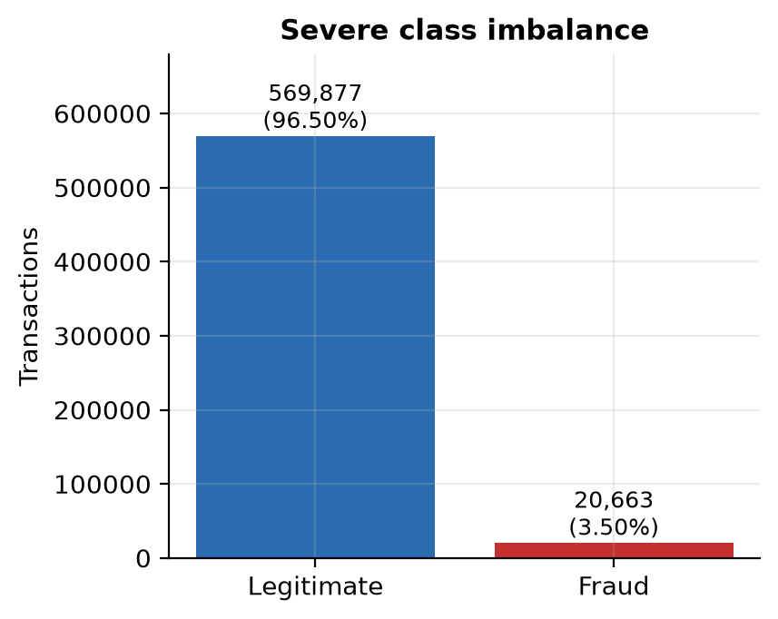
*Class imbalance*

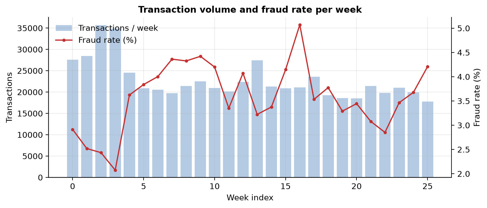
*Volume and fraud rate per week*

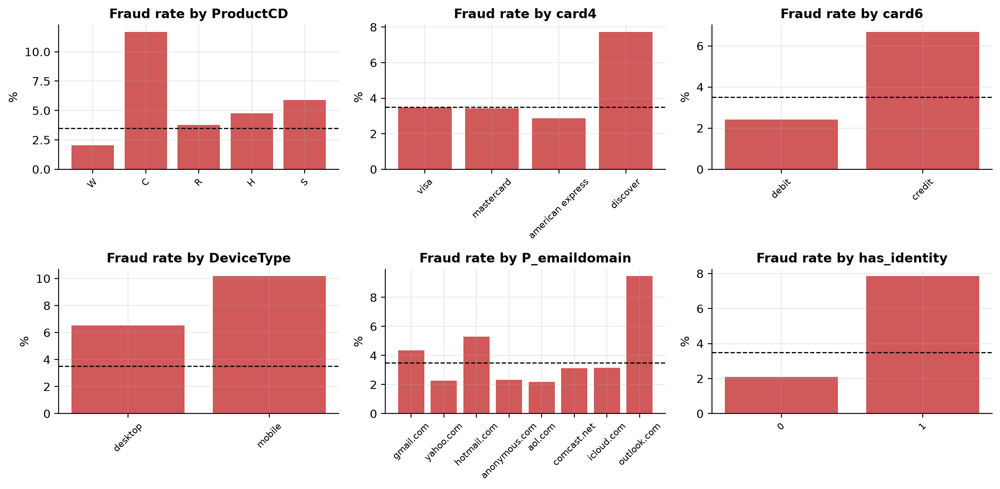
*Fraud rate by category*

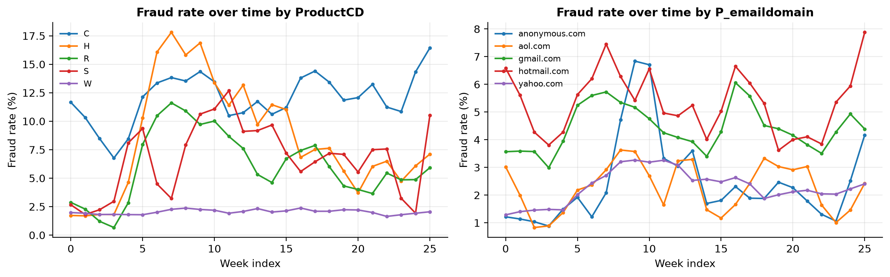
*Fraud rate over time by category (pattern shift)*

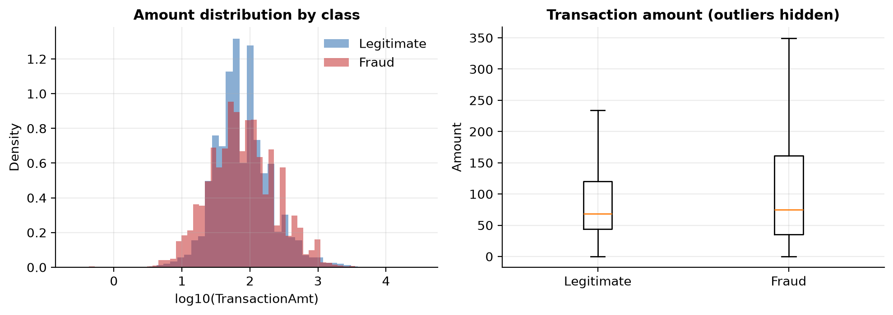
*Transaction amount by class*

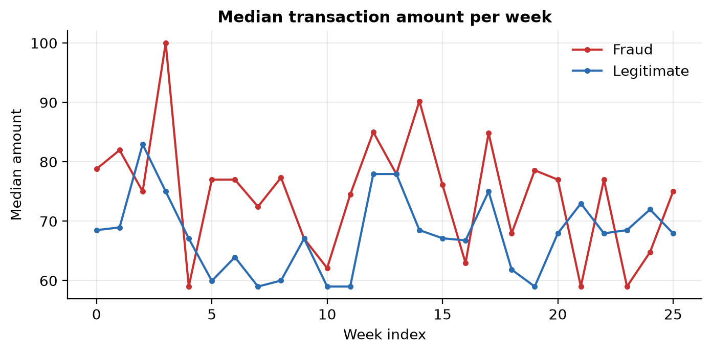
*Median amount per week*

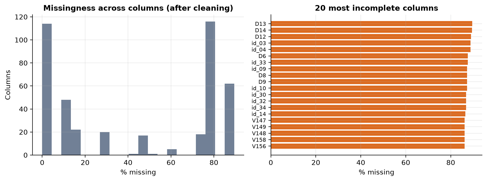
*Missingness*

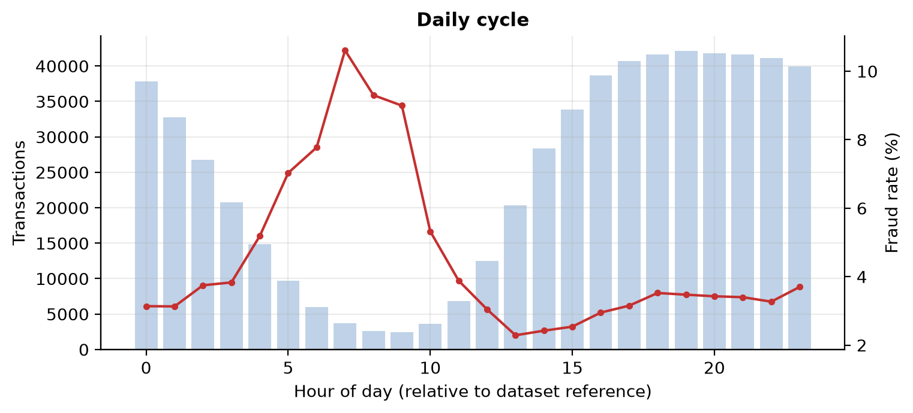
*Daily cycle*

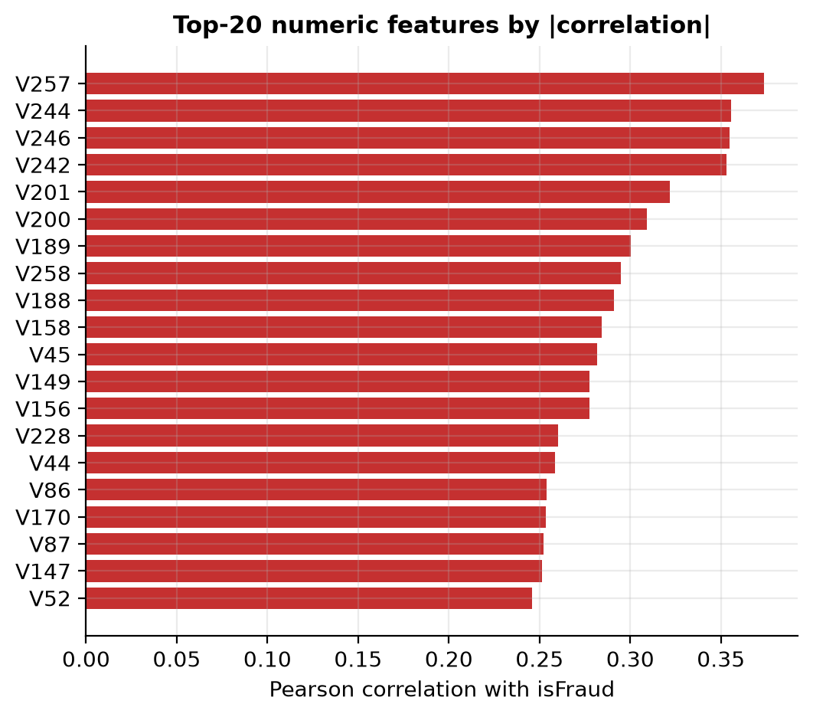
*Correlation with target*

### 3. Chronological simulation and baseline (RQ1)

Windows of **7 days**, **26** windows in total; model trained on the first **8** windows. Features: 424 candidates -> **304** after dropping 120 highly correlated columns (fitted on the training window only).

**No retraining - degradation of the deployed model**

| Metric | First 3 weeks | Last 3 weeks | Relative drop | Slope / week | Spearman rho vs time |
|---|---|---|---|---|---|
| ROC-AUC | 0.8918 | 0.8575 | 3.8% | -0.0030 | -0.60 (p=0.00825) |
| PR-AUC | 0.5461 | 0.4710 | 13.7% | -0.0060 | -0.49 (p=0.0389) |
| Recall @ 1% FPR | 0.4242 | 0.3963 | 6.6% | -0.0026 | -0.25 (p=0.32) |
| F1 | 0.5149 | 0.4782 | 7.1% | -0.0035 | -0.30 (p=0.223) |

**Same learner, different evaluation protocol** (why static splits are optimistic)

| protocol | roc_auc | pr_auc | n_test |
|---|---|---|---|
| Random 80/20 split (static) | 0.9544 | 0.7208 | 118108 |
| Temporal 80/20 split | 0.9077 | 0.5262 | 118108 |
| Deploy-once, no retraining (pooled) | 0.8589 | 0.4775 | 378091 |
| Deploy-once, last 25% of weeks | 0.8450 | 0.4524 | 99985 |

**Model comparison (same chronological protocol)**

| model | mean_roc_auc | mean_pr_auc | first4_pr_auc | last4_pr_auc |
|---|---|---|---|---|
| LightGBM | 0.8556 | 0.4700 | 0.5375 | 0.4537 |
| XGBoost | 0.8328 | 0.4276 | 0.4811 | 0.4097 |

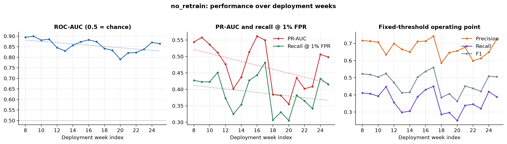
*Performance of the never-retrained model by deployment week*

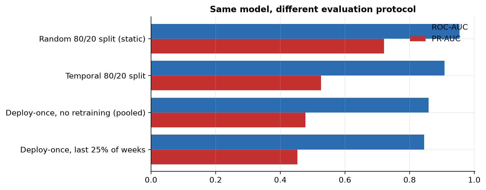
*Static vs temporal vs deploy-once evaluation*

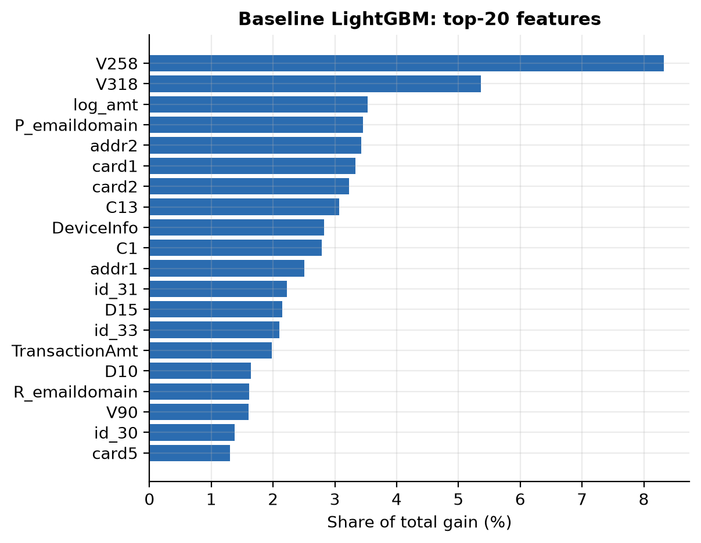
*Top features of the baseline model*

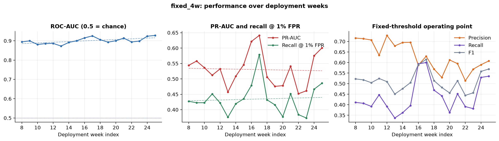
*Fixed 4-week retraining (preview of End-Sem comparison)*

`fixed_4w`: mean PR-AUC 0.5304, 4 retrains, 189s training (no_retrain mean PR-AUC 0.4700).

### 4. Class-imbalance handling

| method | mean_roc_auc | mean_pr_auc | mean_recall_at_1pct_fpr |
|---|---|---|---|
| No imbalance handling | 0.8898 | 0.5234 | 0.4382 |
| Class weighting (scale_pos_weight) | 0.8688 | 0.4975 | 0.4203 |
| Random undersampling (10:1) | 0.8858 | 0.5171 | 0.4329 |
| Undersample 10:1 + SMOTE | 0.8847 | 0.5137 | 0.4279 |

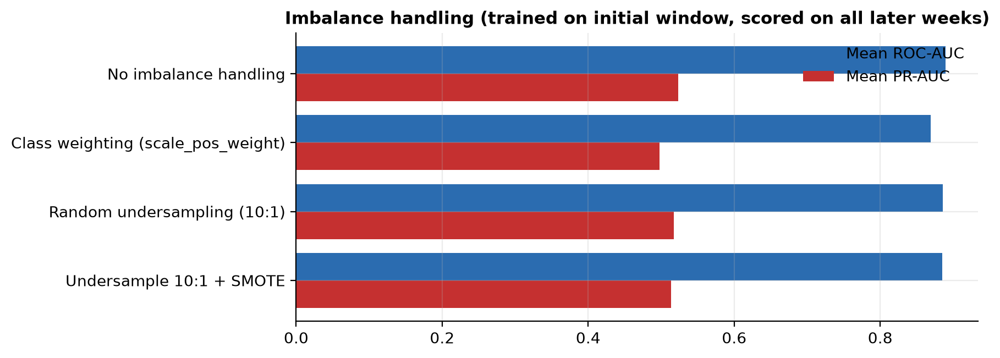
*Imbalance ablation*

### 5. Preliminary drift analysis (RQ2)

Reference degradation onset (PR-AUC >20% below early level for 2 weeks): **week 18**.

| Detector | # detections | First detection (week) | Delay vs onset (weeks) | All detection weeks |
|---|---|---|---|---|
| ADWIN | 12 | 8 | -10 | [8, 9, 10, 13, 15, 17, 18, 19, 21, 22] |
| DDM | 16 | 8 | -10 | [8, 16, 17, 18, 25] |
| ADWIN-miss | 9 | 9 | -9 | [9, 11, 12, 15, 16, 18, 21, 24] |
| DDM-miss | 4 | 8 | -10 | [8, 9] |

Adversarial AUC (reference vs week): first deployment week 0.768, last 0.971, max 0.971. PSI > 0.25 on 3 of the top-20 features in the last week. Most shifted features (mean PSI, last 4 weeks): id_31 (1.6943), id_30 (0.4371), D15 (0.2139), D10 (0.199), DeviceInfo (0.1672).

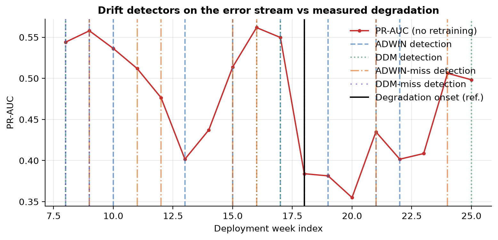
*Detector alarms against measured degradation*

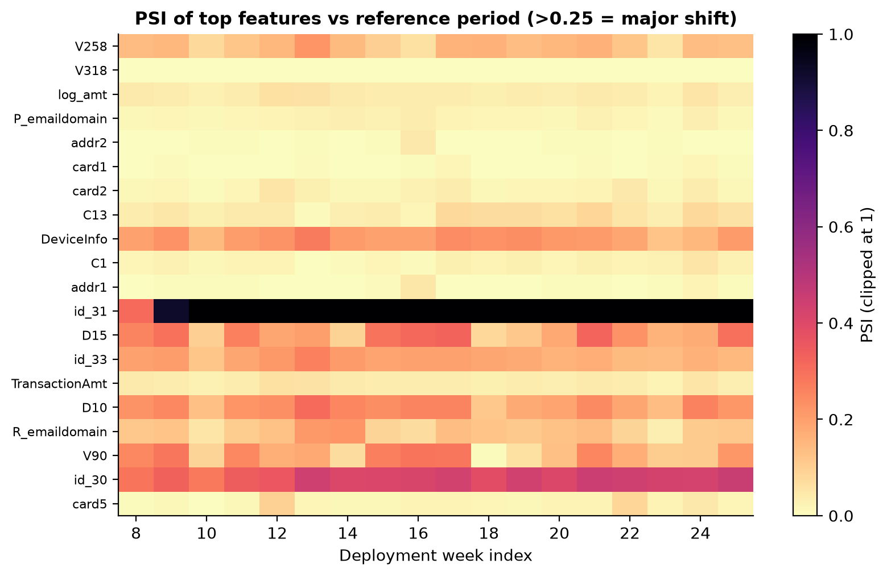
*PSI of top features over time*

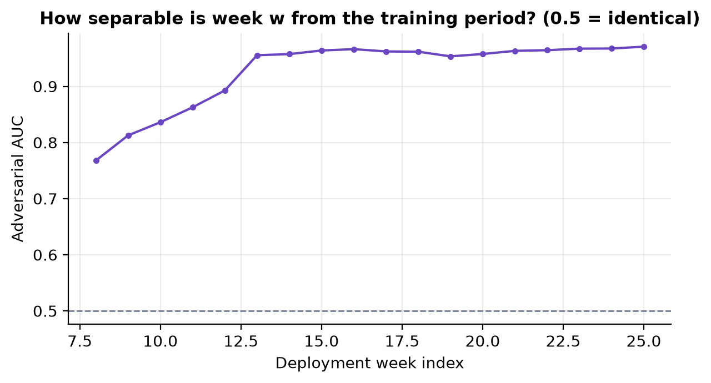
*Adversarial validation AUC over time*

### 6. Retraining policies and cost (RQ3)

Cost = fraud_loss_rate x missed fraud amount + review cost x flagged + retrain cost x #retrains. Defaults (assumptions): review $2.0, retrain $500.0, loss rate 1.0. Break-even retrain cost = price per retraining at which the policy stops paying off vs never retraining. Wilcoxon p: paired per-week PR-AUC vs never retraining.

| policy | label_delay_days | n_retrains | mean_pr_auc | pr_auc_gain_vs_no_retrain_pct | wilcoxon_p_vs_no_retrain | mean_recall_at_1pct_fpr | train_seconds | total_cost | cost_saving_vs_no_retrain_pct | break_even_retrain_cost |
|---|---|---|---|---|---|---|---|---|---|---|
| no_retrain | 0 | 0 | 0.470 | 0.000 | nan | 0.389 | 90.900 | 1666197.125 | 0.000 | nan |
| fixed_2w | 0 | 8 | 0.546 | 16.229 | 0.000 | 0.446 | 623.000 | 1396242.625 | 16.202 | 34244.312 |
| fixed_4w | 0 | 4 | 0.530 | 12.836 | 0.001 | 0.434 | 216.000 | 1400179.750 | 15.966 | 67004.344 |
| fixed_8w | 0 | 2 | 0.511 | 8.810 | 0.005 | 0.420 | 118.600 | 1417863.938 | 14.904 | 124666.594 |
| drift_adwin_miss | 0 | 1 | 0.497 | 5.732 | 0.001 | 0.411 | 60.800 | 1604123.625 | 3.726 | 62573.500 |
| drift_ddm_miss | 0 | 3 | 0.523 | 11.204 | 0.000 | 0.425 | 140.100 | 1486235.375 | 10.801 | 60487.250 |
| drift_adwin | 0 | 4 | 0.534 | 13.532 | 0.000 | 0.434 | 213.100 | 1415778.125 | 15.029 | 63104.750 |
| drift_ddm | 0 | 4 | 0.520 | 10.540 | 0.008 | 0.424 | 270.900 | 1497681.625 | 10.114 | 42628.875 |
| drift_perf_drop | 0 | 2 | 0.518 | 10.276 | 0.002 | 0.421 | 127.300 | 1463290.312 | 12.178 | 101953.406 |
| fixed_4w_delay7d | 7 | 4 | 0.516 | 9.680 | 0.001 | 0.422 | 190.200 | 1494992.875 | 10.275 | 43301.062 |
| fixed_4w_delay14d | 14 | 4 | 0.496 | 5.582 | 0.060 | 0.404 | 192.600 | 1599110.500 | 4.026 | 17271.656 |

Best PR-AUC: **fixed_2w** · cheapest at defaults: **fixed_2w** · best drift-triggered: **drift_adwin**

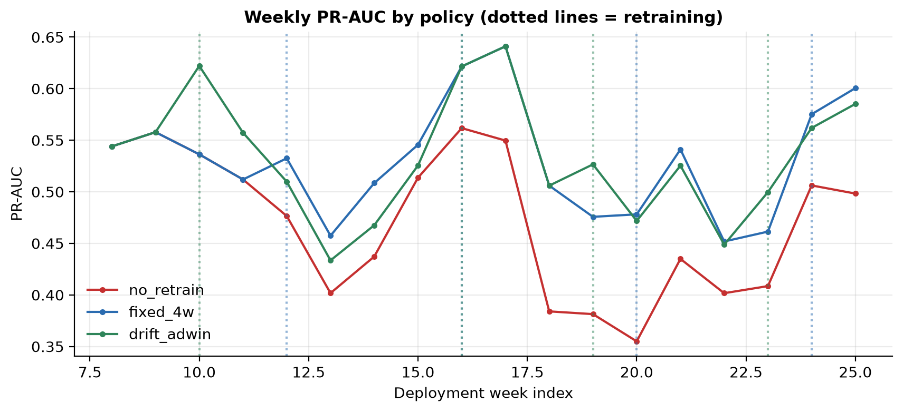
*Weekly PR-AUC by policy*

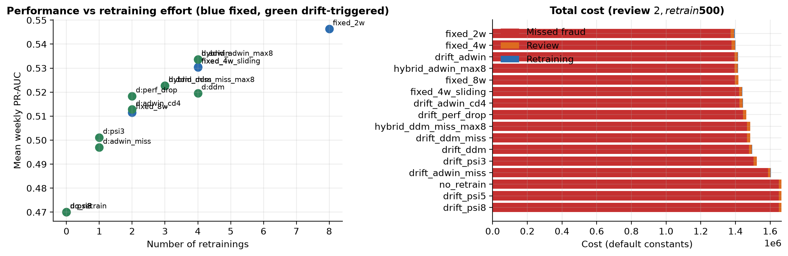
*Performance vs retraining effort, and cost*

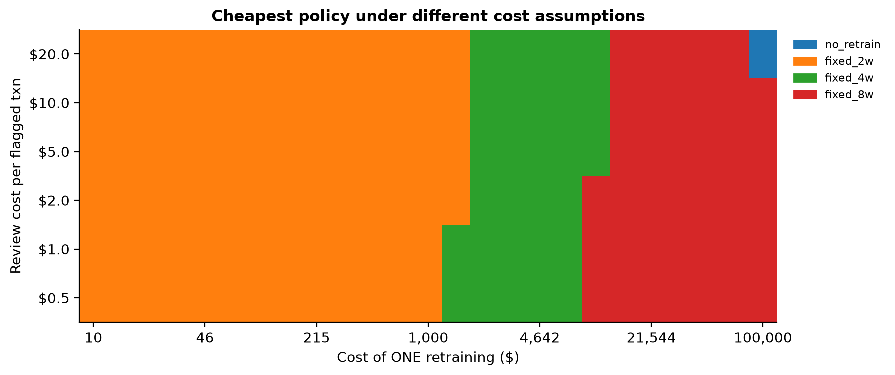
*Cheapest policy under different cost assumptions*

### 7. Explainability with TreeSHAP (RQ4)

Importance rank correlation between the first and last 3 deployment weeks: **1.00**; top-10 features in common: **9/10**; top-5 features carry 20% of total |SHAP| early and 19% late.

Top-10 early: C1, C13, P_emaildomain, card6, card1, log_amt, TransactionAmt, C5, card2, id_31  
Top-10 late: C1, C13, P_emaildomain, card6, card1, TransactionAmt, log_amt, C5, card2, amt_cents

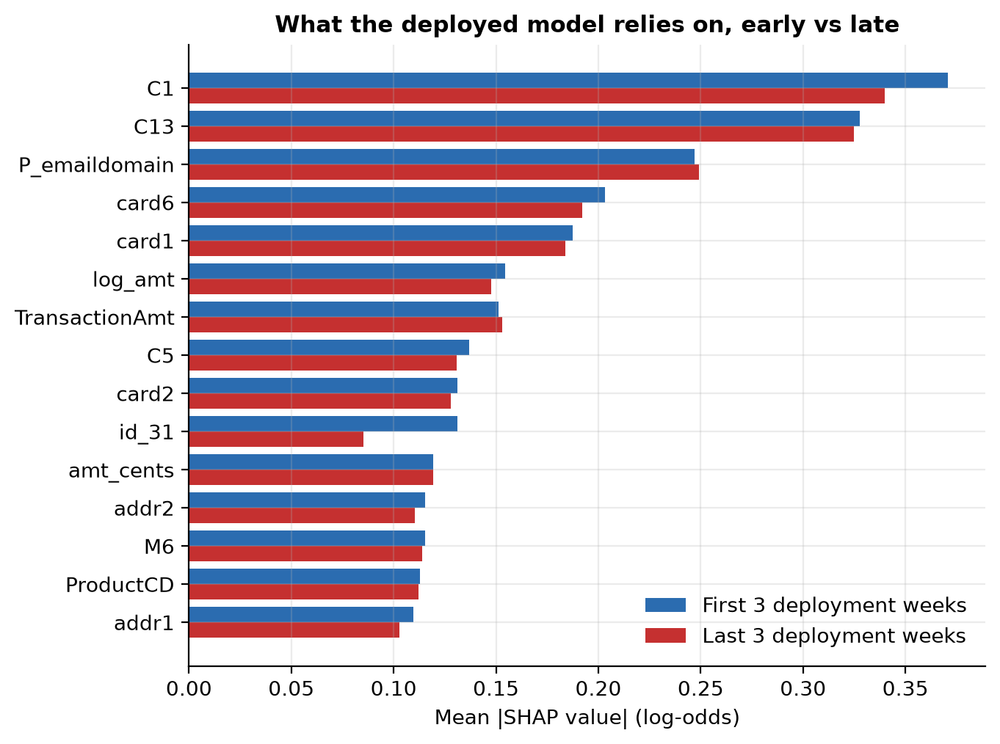
*Mean |SHAP|, early vs late*

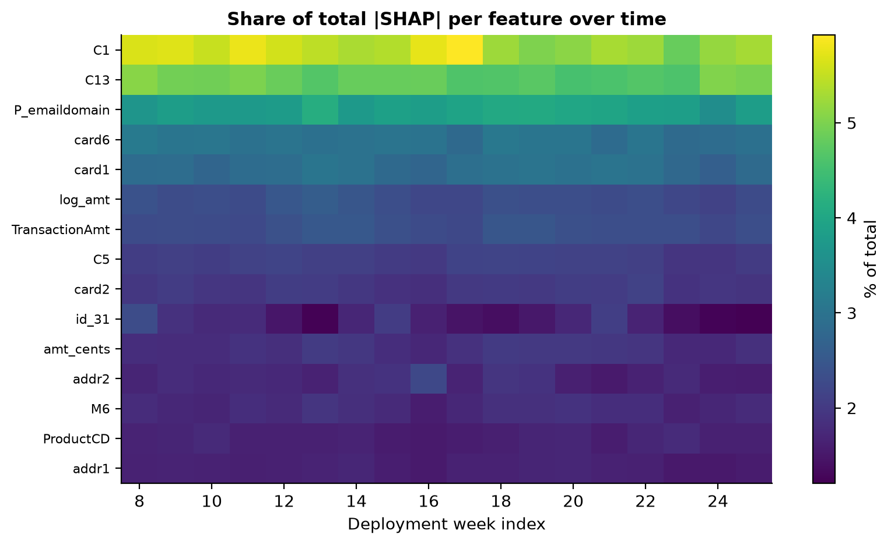
*Share of |SHAP| over time*

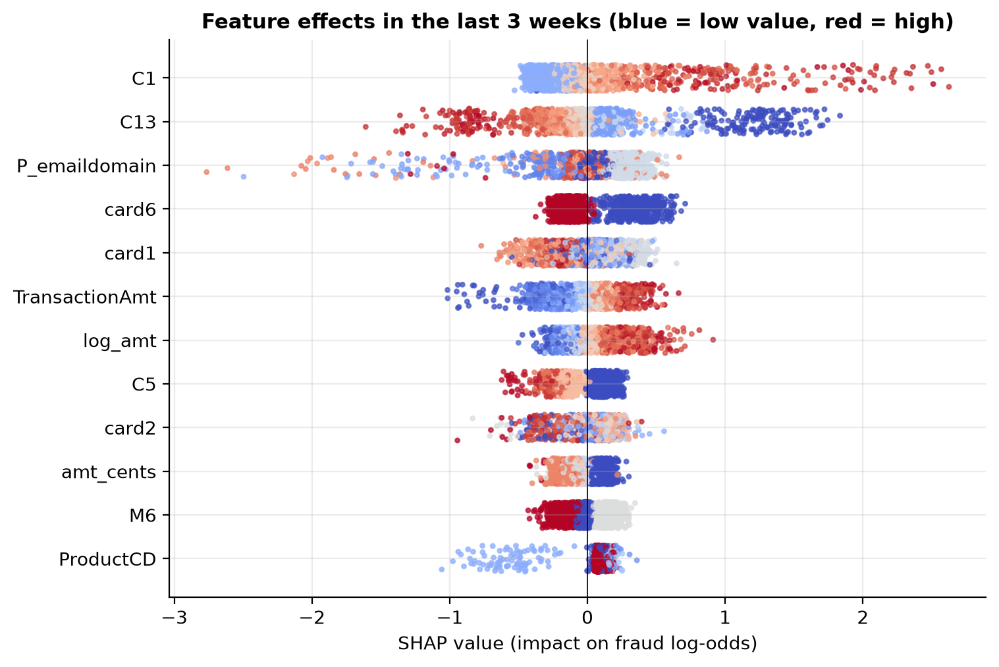
*Feature effects in the last 3 weeks*


<!-- RESULTS:END -->

---

## 5. Roadmap

| Item | Owner | Mid-Sem | End-Sem |
|---|---|---|---|
| Data download, merge, cleaning, quality report | Member 2 | done | CI, reproducibility docs |
| EDA + feature-shift plots | Member 3 | done | - |
| Encoding, feature selection, imbalance ablation, literature | Member 4 | done (literature review in progress) | tuning, sensitivity study, report |
| Chronological simulator, baseline, no-retrain decay | Aditya | done | - |
| Preliminary ADWIN/DDM + PSI + adversarial drift | Aditya | done | - |
| Drift-triggered retraining policy (ADWIN/DDM x error/miss stream, PR-AUC-drop rule) | Aditya | - | implemented; tune + sliding-window variant |
| Cost model + break-even retrain cost + label-delay sensitivity | Aditya | - | implemented; justify constants in paper |
| TreeSHAP explainability (early vs late, per week) | Member 3 | - | implemented; write interpretation |
| Dashboard, tests, CI, Docker, MLflow logging | Aditya + Member 2 | dashboard ready for demo | deploy/share, extend tests |
| Research paper | all (see `paper/`) | intro, related work, method, RQ1 drafted | RQ2-RQ4 results, discussion, polish |

## 6. Changelog

Keep this list updated: **one line per meaningful change, newest first.** Figures and numbers are refreshed automatically above.

- **2026-10-01** - Policy comparison and TreeSHAP run on real data (11 policies incl. label delay 7/14 days); paper RQ2-RQ4 results written. Findings: every retraining policy beats never retraining (PR-AUC +5.7% to +16.2%, paired Wilcoxon p<=0.008 except 14-day delay p=0.060); fixed 2-weekly is best and cheapest; drift-triggered policies only match fixed intervals at similar retrain counts (hypothesis H2 not supported); break-even retrain cost >= $17k vs assumed $500; SHAP ranking stable (rho=0.995) except browser/OS strings id_31/id_30. Docstrings and comments removed from all code (AST-verified identical); tests (7) and dashboard pages re-verified.
- **2026-09-30 (later)** - End-Sem core pulled forward: `DriftTriggered` policy (increase-only ADWIN/DDM on error or fraud-miss streams, cool-down, detector reset after retrain, PR-AUC-drop rule), cost model with assumption-free break-even retrain cost, policy comparison with paired Wilcoxon tests and label-delay sensitivity, exact TreeSHAP early-vs-late analysis, Streamlit dashboard (live replay, drift, policies and cost calculator, explainability), 7 pytest guards (leakage, schedules, cost, end-to-end), GitHub Actions CI, Dockerfile, optional MLflow tracking. First real-data run: static split overstates PR-AUC vs deploy-once, never-retrained PR-AUC falls 13.7% (Spearman rho -0.49, p=0.039), adversarial AUC rises 0.77 -> 0.97.
- **2026-09-30** - Mid-Sem code base created: Kaggle loader, cleaning pipeline, 9 EDA figures, time-safe feature selection, chronological
  simulator with `NoRetrain` and `FixedInterval` policies (label-delay aware), LightGBM baseline with decay statistics
  (slope, Spearman, relative drop), static-vs-temporal-vs-rolling evaluation protocols, LightGBM-vs-XGBoost comparison,
  imbalance ablation (class weight / undersample / SMOTE), ADWIN + DDM on two error streams, PSI/KS heat-map, adversarial-validation drift,
  auto-generated README, IEEE paper skeleton. Verified end-to-end on synthetic data only.
- **2026-09-30** - Work division written (`docs/Work_Division_Midsem_Endsem.md`): Aditya 43% overall, 40% of Mid-Sem.
- **2026-08-25** - Project proposal submitted (`Data_Science_Course_Project_Proposal_Format_Third_Year.pdf`).

## 7. Team

| Name | Role |
|---|---|
| Aditya Katkar | Team Lead - simulator, baseline, drift detection, retraining policies, MLOps |
| Member 2 | Data engineering, pipeline hardening, CI |
| Member 3 | EDA, visualisation, SHAP, dashboard |
| Member 4 | Preprocessing, imbalance, tuning, literature, report |

## 8. References

1. Adebayo, O.S. et al. (2023). Comparative Review of Credit Card Fraud Detection using Machine Learning and Concept Drift Techniques. IJCSMC 12(7).
2. Dal Pozzolo, A., Boracchi, G., Caelen, O., Alippi, C., Bontempi, G. (2018). Credit Card Fraud Detection and Concept-Drift Adaptation with Delayed Supervised Information. IEEE TNNLS.
3. Bifet, A., Gavalda, R. (2007). Learning from Time-Changing Data with Adaptive Windowing. SIAM SDM.
4. Gama, J., Medas, P., Castillo, G., Rodrigues, P. (2004). Learning with Drift Detection. SBIA.
5. IEEE Computational Intelligence Society. IEEE-CIS Fraud Detection Dataset. Kaggle.
